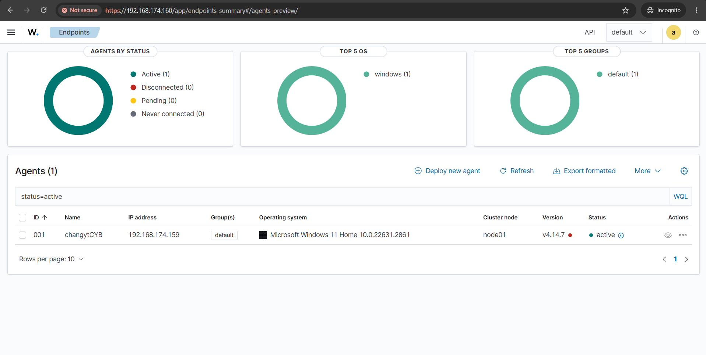
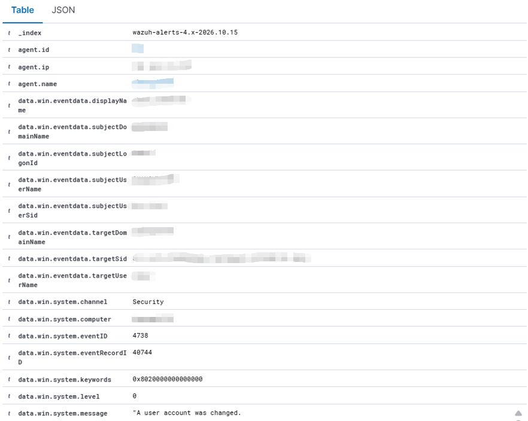
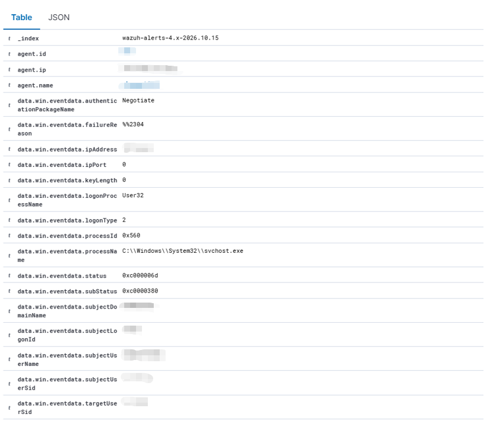
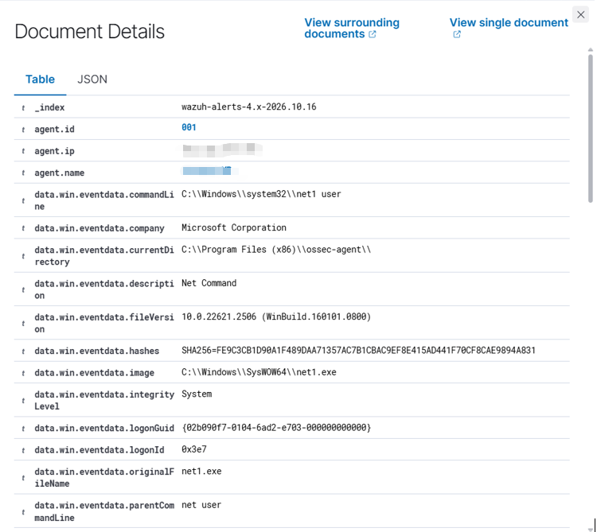

# Windows 11 SOC Lab (Wazuh)

detecting and investigating Windows 11 endpoint activity with Wazuh and Sysmon

## Environment
- Endpoint: Windows 11 VM (VMware Workstation)
- SIEM: Wazuh 4.14.8 on Ubuntu Server 24.04.5 LTS
- Telemetry: Wazuh Windows agent + Sysmon

## Setup
1 install Wazuh agent on the Win11 VM and connect with the manager
2 make sure that agent shows **Active** on wazuh dashboard
3 install Sysmon and add the `Microsoft-Windows-Sysmon/Operational` channel to the agent config

=============================================================================

### Case 01: Account Modification
Windows auditing successfully logged the change and Wazuh made an alert, result shows that it is display-name change, there's not enough evidence to call Case 01 malicious

### Case 02: Failed Logon
Logon type 2 (interactive) from 127.0.0.1 means that someone had typed in the password locally, from that we can know that it's not a remote attack and at the same time, this confirms that the failed logons reach Wazuh

### Case 03: Sysmon Process Creation
Sysmon Event ID 1 is generated for both Notepad and `net1 user` , but only `net1 user` triggered an alert because of mathing discovery rule, at the same time this confirms the pipeline 'Sysmon → Wazuh agent → Wazuh server → dashboard' works 

=============================================================================