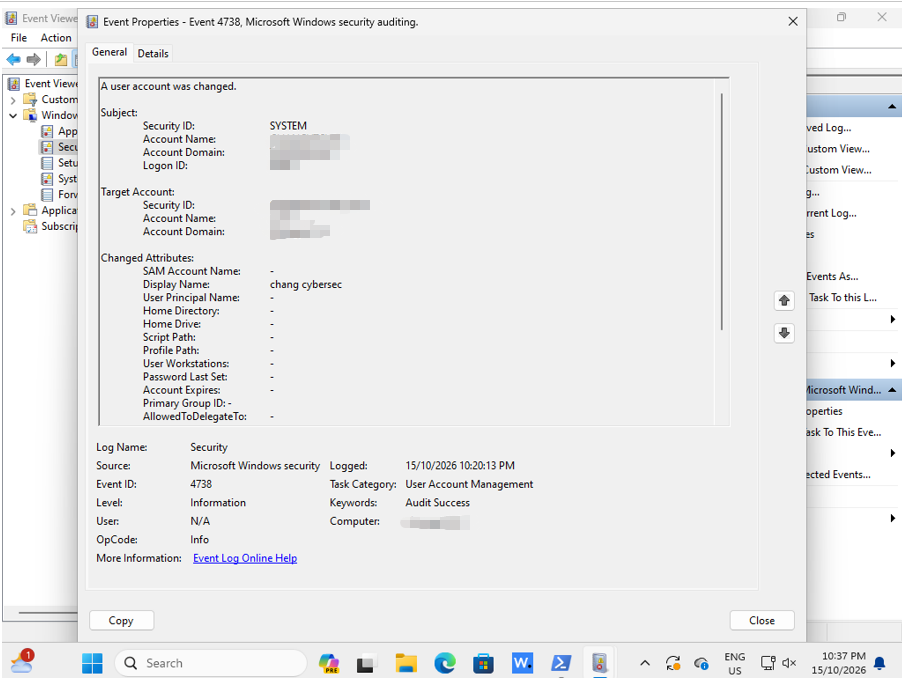

# Case 01: Windows User Account Modification

## Objective
Wazuh detects a user-account change on the Win11 VM

## Test Procedure
1 I change the display name of the local account `cyber` on the Win11 VM
2 check on Wazuh dashboard for the alert

## Telemetry
- Endpoint: changytCYB
- Windows Event ID: 4738 (user account changed)
- Wazuh rule: 60110
- Level: 8
- Target account: cyber
- Change: Display name set to `chang cybersec`
- MITRE ATT&CK: T1098 - Account Manipulation

## Evidence

## Analysis
Windows auditing successfuly recorded the account modification, and Wazuh alert is reported
based on the screenshot, this event shows "display-name change only", does not show who made the change or why, so not enough evidance to flag this case as malicious