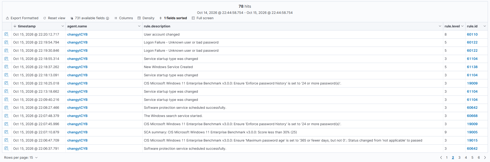
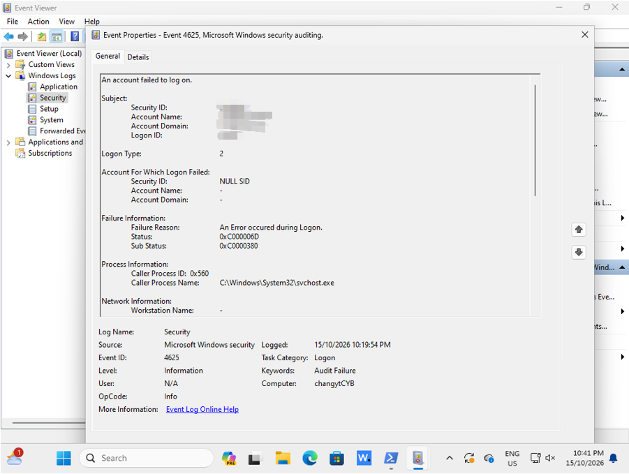

# Case 02: Windows Failed Logon

## Objective
make sure that failed Windows logons are collected and detected by Wazuh

## Test Procedure
1 enter an incorrect password in the Win11 VM
2 check Event Viewer for the Windows event
3 check Wazuh dashboard for the the same alert

## Telemetry
- Endpoint: changytCYB
- Windows Event ID: 4625 (failed logon)
- Wazuh rule: 60122 - Logon Failure: Unknown user or bad password
- Level: 5
- Logon type: 2 (interactive)
- Source address: 127.0.0.1 (loopback)

## Evidence

## Analysis
the event reached Wazuh and matched proves that Windows authentication failures are visible in the SIEM
the source was loopback meaning that this connection are from the machine itself and the logon was interactive as someone was physically typing using keyboard, so this doesnt seems to be a remote attack