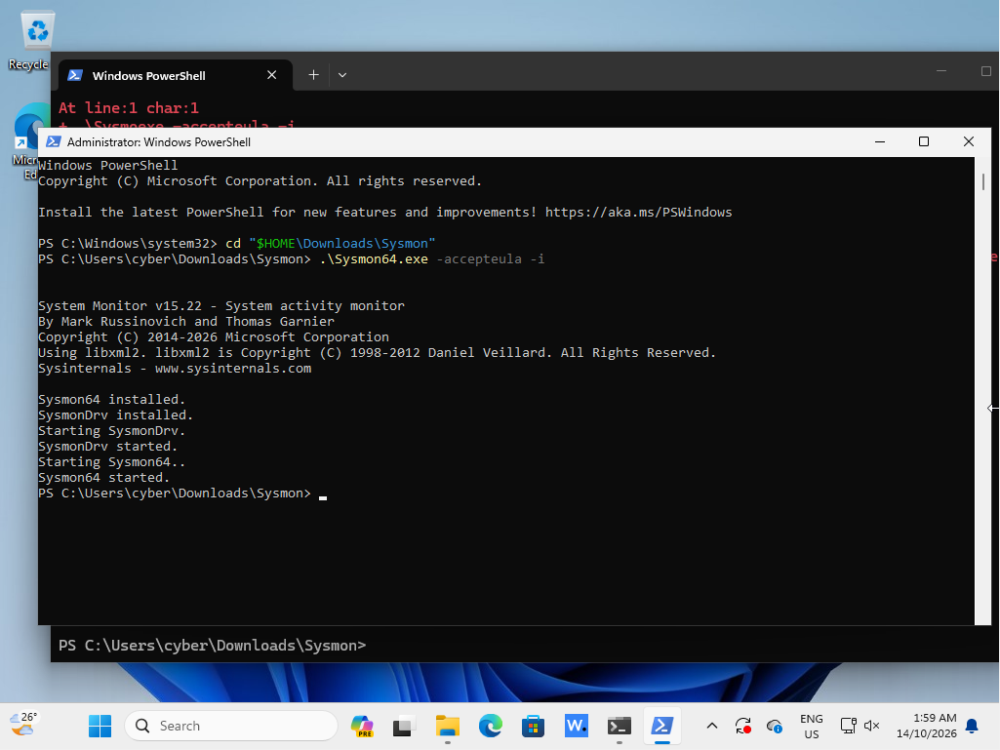
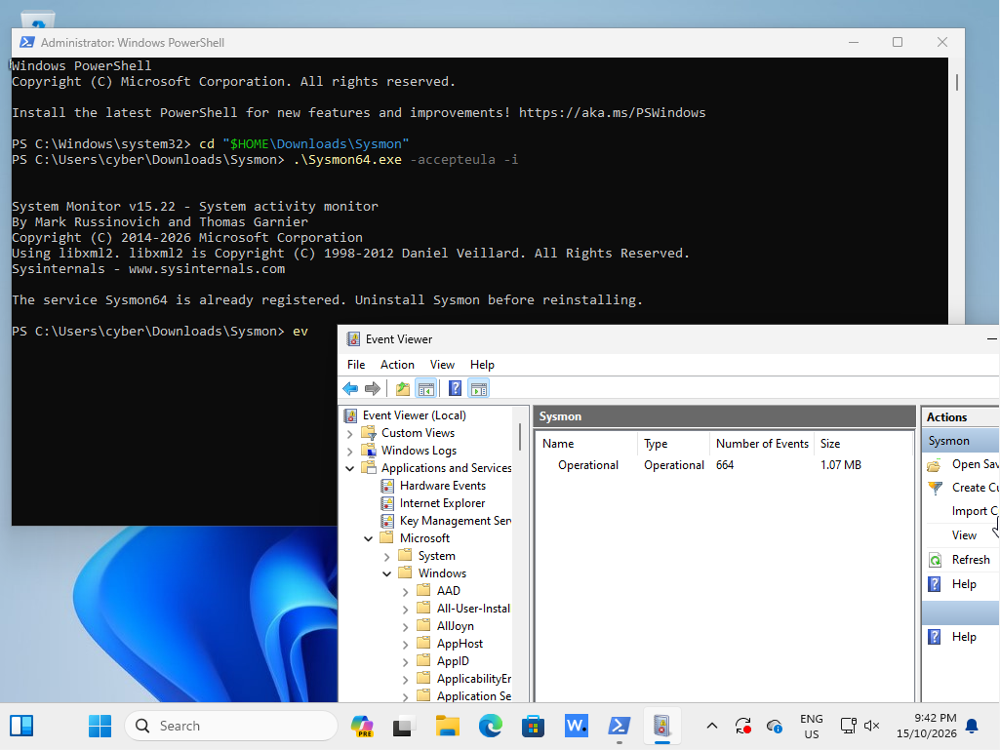
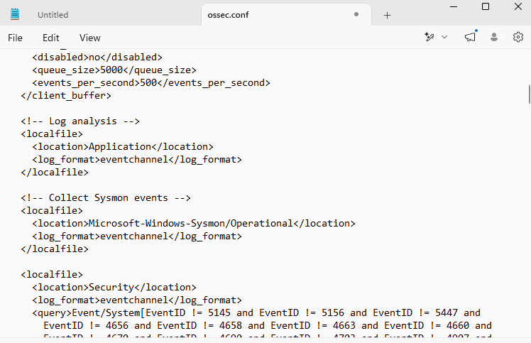
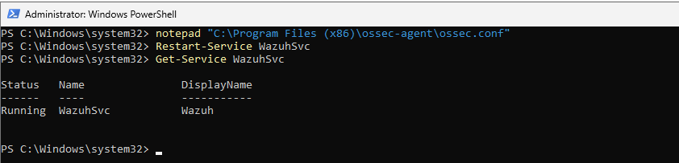
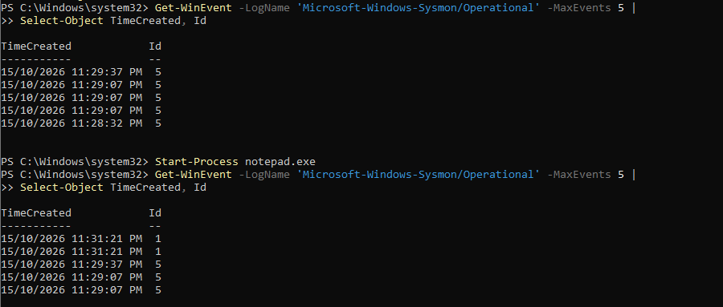

# Case 03: Sysmon Process Creation

## Objective
Sysmon event reach Wazuh and suspicious process activity will trigger detection

## Setup
1 installed Sysmon on the Windows 11 VM
2 confirmed the Sysmon service was running

## Test Procedure
1 add the "Microsoft-Windows-Sysmon/Operational" channel to the Wazuh agent config
2 restart the agent and confirmed it is running
3 open Notepad and checked Sysmon Event ID 1 (Process Create) in Event Viewer
4 run `net1 user` and search Wazuh using `data.win.system.eventID:1`

## Telemetry
- Sysmon Event ID: 1 (Process Create)
- Process: net1.exe
- Command line: `net1 user`
- Wazuh rule: 92031 - Discovery activity executed
- MITRE ATT&CK: T1087 - Account Discovery

## Evidence

## Analysis
both the Notepad and `net1 user` created Sysmon Event ID 1
`net1 user` produced a Wazuh alert, because listing user accounts matches a discovery rule, while opening Notepad is normal activity
this result concluded that the estimated pipeline work: Sysmon -> Wazuh agent -> Wazuh server -> dashboard