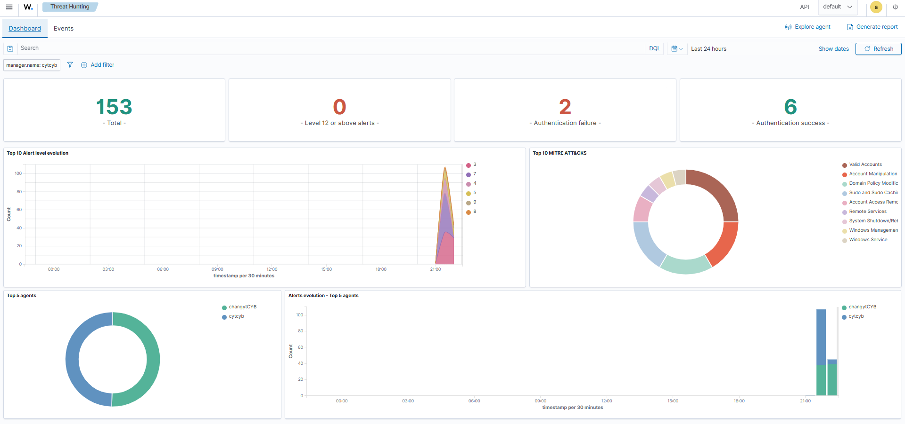
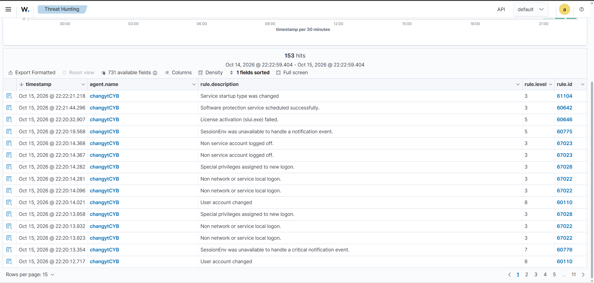

# Windows Event Collection

make sure that events from the Windows 11 VM reaches Wazuh dashboard

## Environment
- Endpoint: Windows 11 VM (VMware Workstation)
- Wazuh server: Wazuh 4.14.8 on Ubuntu Server 24.04.5 LTS
- Agent: Wazuh Windows agent

## What I did
1 make sure that the agent was running and showed as connected
2 Wazuh dashboard and events view for the Windows endpoint working correctly
3 investigate on the incoming events and details of threat hunting

## Result
endpoint-to-SIEM pipeline works as Windows events from the win11 VM is visible in Wazuh

